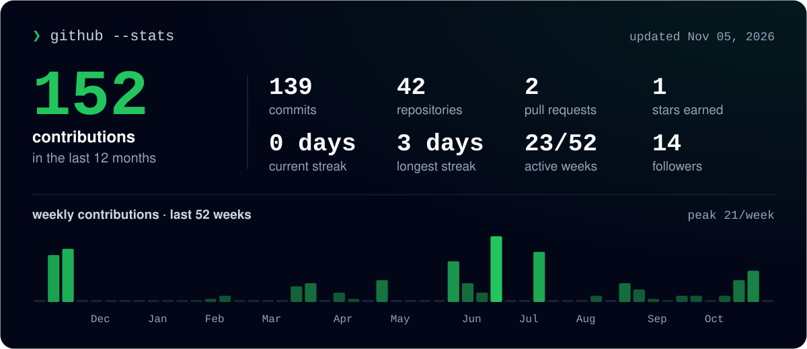
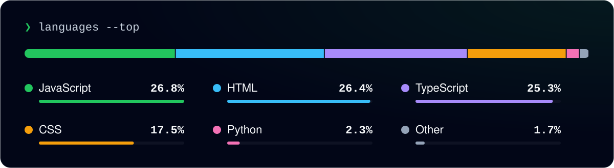

<a href="https://fl.dev.br">
  
</a>

<p align="center">
  <a href="https://fl.dev.br"></a>
  <a href="https://www.linkedin.com/in/felipelemos777"></a>
  <a href="mailto:flplemos@outlook.com"></a>
  
</p>

---

### `$ cat sobre.md`

Sou **desenvolvedor Mendix na TrueChange**, com certificações **Mendix Rapid** e **Intermediate Developer**. Construo aplicações corporativas Low-Code e automatizo processos de ponta a ponta com **Power Automate** e **n8n**.

Também desenvolvo interfaces em **React** e back-ends com **Node.js** e **Python**, e projeto soluções de **IA com RAG e sistemas multiagentes** — do protótipo à integração com o negócio.

Formado em **Análise e Desenvolvimento de Sistemas** e em **Psicologia**: uno base técnica e entendimento de pessoas para entregar software funcional, escalável e fácil de usar.

```yaml
agora:     Desenvolvedor Mendix @ TrueChange (remoto)
paralelo:  Web Designer & Front-End freelancer
foco:      [Mendix, React, Node.js, Python, n8n, RAG]
local:     Natal, RN — Brasil
```

---

### `$ ls ./stack`

<table>
  <tr>
    <td width="50%" valign="top">
      <b>🧩 Low-Code & Automação</b><br/><sub>Aplicações corporativas e fluxos automatizados de ponta a ponta.</sub><br/><br/>
      
      
      <img src="https://img.shields.io/badge/Power_Apps-0E1223?style=for-the-badge&logo=data%3Aimage%2Fsvg%2Bxml%3Bbase64%2CPHN2ZyB3aWR0aD0iOTYiIGhlaWdodD0iOTYiIHZpZXdCb3g9IjAgMCA5NiA5NiIgZmlsbD0ibm9uZSIgeG1sbnM9Imh0dHA6Ly93d3cudzMub3JnLzIwMDAvc3ZnIj48ZGVmcz48ZmlsdGVyIGlkPSJmaWx0ZXIwX2YiPjxmZUZsb29kIGZsb29kLW9wYWNpdHk9IjAiIHJlc3VsdD0iQmFja2dyb3VuZEltYWdlRml4Ii8%2BPGZlQmxlbmQgbW9kZT0ibm9ybWFsIiBpbj0iU291cmNlR3JhcGhpYyIgaW4yPSJCYWNrZ3JvdW5kSW1hZ2VGaXgiIHJlc3VsdD0ic2hhcGUiLz48ZmVHYXVzc2lhbkJsdXIgc3RkRGV2aWF0aW9uPSI0IiByZXN1bHQ9ImVmZmVjdDFfZm9yZWdyb3VuZEJsdXIiLz48L2ZpbHRlcj48ZmlsdGVyIGlkPSJmaWx0ZXIxX2YiPjxmZUZsb29kIGZsb29kLW9wYWNpdHk9IjAiIHJlc3VsdD0iQmFja2dyb3VuZEltYWdlRml4Ii8%2BPGZlQmxlbmQgbW9kZT0ibm9ybWFsIiBpbj0iU291cmNlR3JhcGhpYyIgaW4yPSJCYWNrZ3JvdW5kSW1hZ2VGaXgiIHJlc3VsdD0ic2hhcGUiLz48ZmVHYXVzc2lhbkJsdXIgc3RkRGV2aWF0aW9uPSIwLjM4IiByZXN1bHQ9ImVmZmVjdDFfZm9yZWdyb3VuZEJsdXIiLz48L2ZpbHRlcj48bGluZWFyR3JhZGllbnQgaWQ9InBhaW50MF9saW5lYXIiIHgxPSI3MSIgeTE9Ijk2LjAwMDIiIHgyPSIxNSIgeTI9Ii00MC45OTk4IiBncmFkaWVudFVuaXRzPSJ1c2VyU3BhY2VPblVzZSI%2BPHN0b3Agc3RvcC1jb2xvcj0iIzc0Mjc3NCIvPjxzdG9wIG9mZnNldD0iMSIgc3RvcC1jb2xvcj0iI0JCMzVBNCIvPjwvbGluZWFyR3JhZGllbnQ%2BPGxpbmVhckdyYWRpZW50IGlkPSJwYWludDFfbGluZWFyIiB4MT0iMzIiIHkxPSIwLjAwMDI0MzYiIHgyPSI3OCIgeTI9Ijk2LjAwMDIiIGdyYWRpZW50VW5pdHM9InVzZXJTcGFjZU9uVXNlIj48c3RvcCBzdG9wLWNvbG9yPSIjRTQ4Q0M3Ii8%2BPHN0b3Agb2Zmc2V0PSIxIiBzdG9wLWNvbG9yPSIjRDQ2N0I5Ii8%2BPC9saW5lYXJHcmFkaWVudD48bGluZWFyR3JhZGllbnQgaWQ9InBhaW50Ml9saW5lYXIiIHgxPSI2MiIgeTE9IjI5LjAwMDIiIHgyPSI3NiIgeTI9IjcyIiBncmFkaWVudFVuaXRzPSJ1c2VyU3BhY2VPblVzZSI%2BPHN0b3Agc3RvcC1jb2xvcj0iI0U5QTFDQiIvPjxzdG9wIG9mZnNldD0iMSIgc3RvcC1jb2xvcj0iI0U0OENDNyIvPjwvbGluZWFyR3JhZGllbnQ%2BPGNsaXBQYXRoIGlkPSJjbGlwMCI%2BPHJlY3Qgd2lkdGg9Ijk2IiBoZWlnaHQ9Ijk2IiBmaWxsPSJ3aGl0ZSIvPjwvY2xpcFBhdGg%2BPGNsaXBQYXRoIGlkPSJjbGlwMSI%2BPHJlY3Qgd2lkdGg9Ijk2IiBoZWlnaHQ9Ijk2IiBmaWxsPSJ3aGl0ZSIvPjwvY2xpcFBhdGg%2BPGNsaXBQYXRoIGlkPSJjbGlwMiI%2BPHJlY3Qgd2lkdGg9Ijk2IiBoZWlnaHQ9Ijk2IiBmaWxsPSJ3aGl0ZSIgdHJhbnNmb3JtPSJ0cmFuc2xhdGUoMCAwLjAwMDEyMjA3KSIvPjwvY2xpcFBhdGg%2BPC9kZWZzPjxnIGNsaXAtcGF0aD0idXJsKCNjbGlwMCkiPjxnIGNsaXAtcGF0aD0idXJsKCNjbGlwMSkiPjxnIGNsaXAtcGF0aD0idXJsKCNjbGlwMikiPjxtYXNrIGlkPSJtYXNrMCIgbWFzay10eXBlPSJhbHBoYSIgbWFza1VuaXRzPSJ1c2VyU3BhY2VPblVzZSIgeD0iLTEiIHk9IjEiIHdpZHRoPSI5NyIgaGVpZ2h0PSI5NCI%2BPHBhdGggZD0iTTEuNDU3MTUgNDQuMDQ5Qy0wLjUyMjIzNyA0Ni4zMTExIC0wLjUyMjIzOCA0OS42ODg5IDEuNDU3MTUgNTEuOTUxTDM2Ljk4OTcgOTIuNTU5NkMzOC41ODMzIDk0LjM4MSA0MS40MTY3IDk0LjM4MSA0My4wMTAzIDkyLjU1OTZMNDYuODM2NyA4OC4xODY2TDUxLjA1MDQgOTIuNzgzM0M1Mi42MzU4IDk0LjUxMjggNTUuMzYyMyA5NC41MTI4IDU2Ljk0NzYgOTIuNzgzM0w5NC4yODI1IDUyLjA1NDNDOTYuMzg1MyA0OS43NjA0IDk2LjM4NTMgNDYuMjM5NiA5NC4yODI1IDQzLjk0NTdMNTYuOTQ3NiAzLjIxNjY3QzU1LjM2MjMgMS40ODcyIDUyLjYzNTggMS40ODcyIDUxLjA1MDQgMy4yMTY2N0w0Ni44MzY3IDcuODEzNDFMNDMuMDEwMyAzLjQ0MDM1QzQxLjQxNjcgMS42MTkwNCAzOC41ODMzIDEuNjE5MDQgMzYuOTg5NyAzLjQ0MDM1TDEuNDU3MTUgNDQuMDQ5WiIgZmlsbD0id2hpdGUiLz48L21hc2s%2BPGcgbWFzaz0idXJsKCNtYXNrMCkiPjxwYXRoIGQ9Ik00MCA5NkwtMiA0OEw0MCAwTDgyIDQ4TDQwIDk2WiIgZmlsbD0idXJsKCNwYWludDBfbGluZWFyKSIvPjxnIGZpbHRlcj0idXJsKCNmaWx0ZXIwX2YpIj48cGF0aCBkPSJNNTMuOTk5IDJMOTcuOTk5IDUwTDUzLjk5OSA5OEwzNC40NzY3IDc2LjcwMjlDMzMuMDc0OCA3NS4xNzM2IDMzLjA3NDggNzIuODI2NCAzNC40NzY3IDcxLjI5NzFMNTEuNTIxNCA1Mi43MDI5QzUyLjkyMzIgNTEuMTczNiA1Mi45MjMyIDQ4LjgyNjQgNTEuNTIxNCA0Ny4yOTcxTDM0LjQ3NjcgMjguNzAyOUMzMy4wNzQ4IDI3LjE3MzYgMzMuMDc0OCAyNC44MjY0IDM0LjQ3NjcgMjMuMjk3MUw1My45OTkgMloiIGZpbGw9ImJsYWNrIiBmaWxsLW9wYWNpdHk9IjAuMzIiLz48L2c%2BPGcgZmlsdGVyPSJ1cmwoI2ZpbHRlcjFfZikiPjxwYXRoIGQ9Ik01My45OTkgMC4zODAxMjdMOTcuOTk5IDQ4LjM4MDFMNTMuOTk5IDk2LjM4MDFMMzQuNDc2NyA3NS4wODNDMzMuMDc0OCA3My41NTM3IDMzLjA3NDggNzEuMjA2NSAzNC40NzY3IDY5LjY3NzJMNTEuNTIxNCA1MS4wODNDNTIuOTIzMiA0OS41NTM3IDUyLjkyMzIgNDcuMjA2NSA1MS41MjE0IDQ1LjY3NzJMMzQuNDc2NyAyNy4wODNDMzMuMDc0OCAyNS41NTM3IDMzLjA3NDggMjMuMjA2NSAzNC40NzY3IDIxLjY3NzJMNTMuOTk5IDAuMzgwMTI3WiIgZmlsbD0iYmxhY2siIGZpbGwtb3BhY2l0eT0iMC4yNCIvPjwvZz48cGF0aCBkPSJNNTMuOTk5IDBMOTcuOTk5IDQ4TDUzLjk5OSA5NkwzNC40NzY3IDc0LjcwMjlDMzMuMDc0OCA3My4xNzM2IDMzLjA3NDggNzAuODI2NCAzNC40NzY3IDY5LjI5NzFMNTEuNTIxNCA1MC43MDI5QzUyLjkyMzIgNDkuMTczNiA1Mi45MjMyIDQ2LjgyNjQgNTEuNTIxNCA0NS4yOTcxTDM0LjQ3NjcgMjYuNzAyOUMzMy4wNzQ4IDI1LjE3MzYgMzMuMDc0OCAyMi44MjY0IDM0LjQ3NjcgMjEuMjk3MUw1My45OTkgMFoiIGZpbGw9InVybCgjcGFpbnQxX2xpbmVhcikiLz48cGF0aCBkPSJNNzMuMDUxNCAyNy4yMTY3Qzc0LjYzNjcgMjUuNDg3MiA3Ny4zNjMzIDI1LjQ4NzIgNzguOTQ4NiAyNy4yMTY3TDk4IDQ4TDc4Ljk0ODYgNjguNzgzM0M3Ny4zNjMzIDcwLjUxMjggNzQuNjM2NyA3MC41MTI4IDczLjA1MTQgNjguNzgzM0w1Ny43MTY1IDUyLjA1NDNDNTUuNjEzNyA0OS43NjA0IDU1LjYxMzcgNDYuMjM5NiA1Ny43MTY1IDQzLjk0NTdMNzMuMDUxNCAyNy4yMTY3WiIgZmlsbD0idXJsKCNwYWludDJfbGluZWFyKSIvPjwvZz48L2c%2BPC9nPjwvZz48L3N2Zz4%3D" alt="Power Apps" />
      
    </td>
    <td width="50%" valign="top">
      <b>🤖 Inteligência Artificial</b><br/><sub>Recuperação de contexto e agentes cooperativos.</sub><br/><br/>
      
      
      
      
    </td>
  </tr>
  <tr>
    <td width="50%" valign="top">
      <b>🎨 Front-End & UI</b><br/><sub>Interfaces responsivas, acessíveis e com atenção à experiência.</sub><br/><br/>
      
      
      
      
      
      
    </td>
    <td width="50%" valign="top">
      <b>🗄️ Back-End, Dados & DevOps</b><br/><sub>APIs, persistência e versionamento com boas práticas.</sub><br/><br/>
      
      
      
      
      
      
      
    </td>
  </tr>
</table>

---

### `$ ls ./projetos --destaques`

<table>
  <tr>
    <td width="50%" valign="top">
      <a href="https://gestaoananails.vercel.app"></a>
      <h4>Ana Nails · Gestão</h4>
      <sub>PWA mobile-first para uma nail designer gerenciar atendimentos, clientes, despesas e faturamento, com lembretes via Web Push (pg_cron + Edge Functions).</sub><br/><br/>
      <code>React 19</code> <code>Supabase</code> <code>PWA</code> <code>Tailwind</code><br/><br/>
      <a href="https://gestaoananails.vercel.app">▸ ao vivo</a> · <a href="https://github.com/flplemos/gestaoananails">▸ código</a>
    </td>
    <td width="50%" valign="top">
      <a href="https://espetaria-mvp.vercel.app"></a>
      <h4>Espetaria do Gaguinho — Pedidos</h4>
      <sub>POS/KDS em tempo real: o garçom lança a comanda no celular e ela aparece na hora na churrasqueira e no caixa.</sub><br/><br/>
      <code>React 19</code> <code>Supabase Realtime</code> <code>Tailwind</code><br/><br/>
      <a href="https://espetaria-mvp.vercel.app">▸ ao vivo</a> · <a href="https://github.com/flplemos/espetaria-mvp">▸ código</a>
    </td>
  </tr>
  <tr>
    <td width="50%" valign="top">
      <a href="https://flplemos.github.io/espetariadogaguinho/"></a>
      <h4>Espetaria do Gaguinho — Cardápio</h4>
      <sub>Cardápio digital com carrinho, combos personalizáveis, frete por CEP e pedido finalizado direto no WhatsApp.</sub><br/><br/>
      <code>JavaScript</code> <code>ViaCEP</code> <code>WhatsApp</code><br/><br/>
      <a href="https://flplemos.github.io/espetariadogaguinho/">▸ ao vivo</a> · <a href="https://github.com/flplemos/espetariadogaguinho">▸ código</a>
    </td>
    <td width="50%" valign="top">
      <a href="https://costs-sepia.vercel.app/"></a>
      <h4>Costs — Gerenciador de Projetos</h4>
      <sub>Gestão de projetos e custos em React, com roteamento e estado global.</sub><br/><br/>
      <code>React</code> <code>JavaScript</code> <code>CSS</code><br/><br/>
      <a href="https://costs-sepia.vercel.app/">▸ ao vivo</a> · <a href="https://github.com/flplemos/costs">▸ código</a>
    </td>
  </tr>
</table>

<sub>Mais: <a href="https://github.com/flplemos/shorts-summary">Shorts Summary</a> (resumo de vídeos com IA · Node.js + Transformers) · <a href="https://github.com/flplemos/pokedex">Pokédex Felps Edition</a> (PokéAPI + Chart.js) · <a href="https://fl.dev.br/#projetos">ver todos no portfolio →</a></sub>

---

### `$ github --stats`

<p align="center">
  
</p>

<p align="center">
  
</p>

<p align="center">
  
</p>

---

### `$ cat certificacoes.md`

| | Certificação | Emissor | Data |
|---|---|---|---|
| 🏅 | Mendix Intermediate Developer | Mendix | set. 2026 |
| 🏅 | Mendix Rapid Developer | Mendix | ago. 2026 |
| 🧠 | Engenharia de LLMs e Sistemas Agentic | Senac RN | jul. 2026 |
| ⚡ | Automação com n8n (Santander 2025) | DIO | dez. 2025 |
| 🪟 | Microsoft Elevate Educator Expert 2026-2027 | Microsoft | set. 2026 |

<p align="center">
  <sub><code>❯ exit</code> &nbsp;·&nbsp; feito com 💚 em Natal, RN &nbsp;·&nbsp; cards gerados diariamente por GitHub Actions</sub>
</p>
